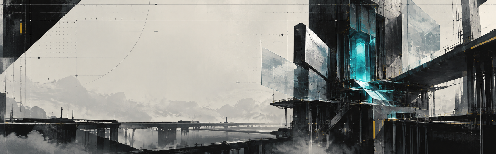
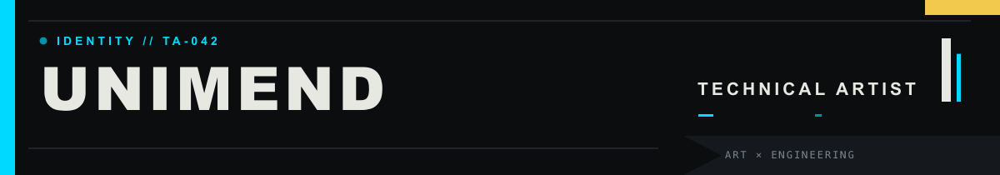
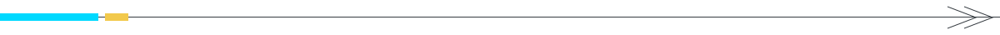

<div align="center">



<br />



<br />

[](https://www.artstation.com/unimend)
[](https://www.zhihu.com/people/styx-q)
[](https://space.bilibili.com/32303300)

</div>

<br />

<table>
<tr>
<td width="58%" valign="top">

### `// OPERATOR PROFILE`

```text
CALLSIGN      UNIMEND
ROLE          TECHNICAL ARTIST
FOCUS         REAL-TIME RENDERING / TOOLS / VISUAL SYSTEMS
STATUS        BUILDING AT THE BORDER OF ART × ENGINEERING
```

I build the invisible bridge between **visual ambition** and **real-time constraints** — shaders, rendering experiments, procedural workflows, artist tools, and interfaces with a point of view.

我是一名技术美术。喜欢把渲染、工具与视觉设计揉在一起，寻找「艺术表达」和「工程约束」之间更漂亮的解法。

</td>
<td width="42%" valign="top">

### `// CURRENT SIGNAL`

- ◈ Real-time rendering & shader studies
- ◇ Unity / Unreal production workflows
- ◈ Blender procedural exploration
- ◇ Android widgets & interaction experiments
- ◈ Tooling that makes artists faster

> **SYSTEM NOTE**<br />
> Make it work. Make it clear. Then make it unforgettable.

</td>
</tr>
</table>



## `01 / SELECTED OPERATIONS`

<table>
<tr>
<td width="50%" valign="top">

### [UnityRender-BaseLearn](https://github.com/Unimend/UnityRender-BaseLearn)

`REAL-TIME RENDERING` · `SHADERLAB` · `UNITY`

A field notebook for rendering research and the harder parts of the technical-art pipeline.

</td>
<td width="50%" valign="top">

### [Unimend-Webpage](https://github.com/Unimend/Unimend-Webpage)

`VISUAL DESIGN` · `WEB` · `EXPERIMENT`

An evolving personal space for visual experiments, notes, and work in progress.

</td>
</tr>
<tr>
<td width="50%" valign="top">

### [nothing-keyboard](https://github.com/Unimend/nothing-keyboard)

`KOTLIN` · `ANDROID` · `PRODUCT DESIGN`

A Nothing-inspired Android keyboard with pinyin preedit, gestures, and dot-matrix accents.

</td>
<td width="50%" valign="top">

### [nothing-weather-widget](https://github.com/Unimend/nothing-weather-widget)

`JAVA` · `ANDROID WIDGET` · `DATA VISUALIZATION`

Weather and air-quality information translated into a restrained, glanceable home-screen system.

</td>
</tr>
</table>

<div align="right">

`VIEW ALL REPOSITORIES →` **[github.com/Unimend?tab=repositories](https://github.com/Unimend?tab=repositories)**

</div>


## `02 / TECHNICAL LOADOUT`

<div align="center">


`SHADERS`　`REAL-TIME VFX`　`PROCEDURAL CONTENT`　`PIPELINE TOOLS`　`TECHNICAL DESIGN`

</div>


## `03 / TELEMETRY`

<div align="center">


<br />

<sub>`END OF TRANSMISSION // SIGNAL REMAINS OPEN`</sub>

</div>
