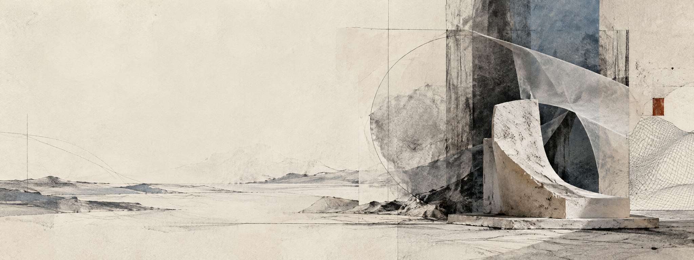
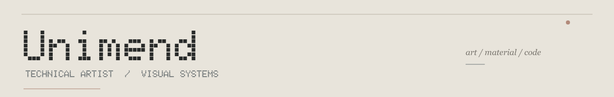
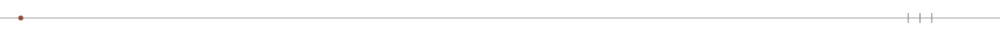
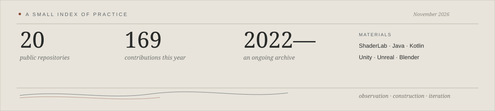

<a href="https://www.artstation.com/unimend">ArtStation</a>　·　
<a href="https://www.zhihu.com/people/styx-q">知乎</a>　·　
<a href="https://space.bilibili.com/32303300">哔哩哔哩</a>

 

### About

I work between image-making and engineering: building shaders, real-time visual systems, procedural workflows and tools for artists.

美术生出身，现为技术美术。我的兴趣不只在于让画面“正确地运行”，也在于研究材质、空间、光线和秩序如何共同构成一种视觉经验。

I am interested in the moment where a sketch becomes a system — and where a system still retains the sensitivity of a sketch.

 

### Selected work

<table>
<tr>
<td width="50%" valign="top">

#### [UnityRender-BaseLearn](https://github.com/Unimend/UnityRender-BaseLearn)

Studies in real-time rendering, ShaderLab and the visual logic behind a production image.

`rendering`　`shader`　`Unity`

</td>
<td width="50%" valign="top">

#### [Unimend-Webpage](https://github.com/Unimend/Unimend-Webpage)

An evolving personal space for visual experiments, notes and unfinished thoughts.

`visual design`　`web`　`archive`

</td>
</tr>
<tr>
<td width="50%" valign="top">

#### [nothing-keyboard](https://github.com/Unimend/nothing-keyboard)

An Android keyboard shaped as much by typography and interaction as by implementation.

`Kotlin`　`interaction`　`product`

</td>
<td width="50%" valign="top">

#### [nothing-weather-widget](https://github.com/Unimend/nothing-weather-widget)

Weather and air-quality data translated into a quiet, glanceable visual object.

`Java`　`data`　`interface`

</td>
</tr>
</table>

<a href="https://github.com/Unimend?tab=repositories">All repositories ↗</a>

 

### Practice

`Real-time rendering`　　`Shaders`　　`Procedural systems`　　`Artist tools`

`Unity`　　`Unreal Engine`　　`Blender`　　`C#`　　`Kotlin`

My practice moves between **observation**, **construction**, and **iteration**. Tools are not separate from aesthetics; they quietly determine which images are possible.

 

### Notes / telemetry

Open to conversations about rendering, tools, visual systems and the spaces between them.

