

<a href="https://www.artstation.com/artwork/AlGPRq">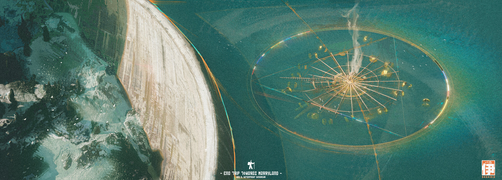</a>

<a href="https://www.artstation.com/artwork/AlGPRq">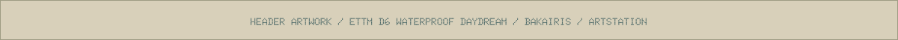</a>

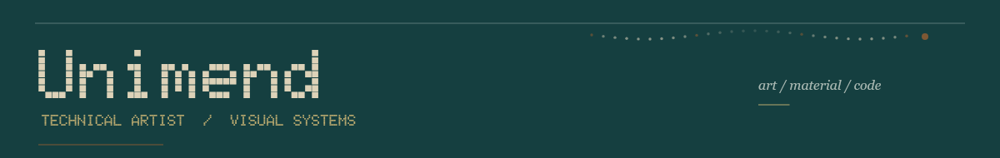

<a href="https://www.artstation.com/unimend">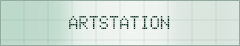</a>
<a href="https://www.zhihu.com/people/styx-q">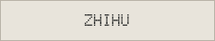</a>
<a href="https://space.bilibili.com/32303300">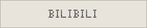</a>

 

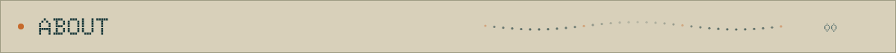

I work between image-making and engineering: building shaders, real-time visual systems, procedural workflows and tools for artists.

美术生出身，现为技术美术。我的兴趣不只在于让画面“正确地运行”，也在于研究材质、空间、光线和秩序如何共同构成一种视觉经验。

I am interested in the moment where a sketch becomes a system — and where a system still retains the sensitivity of a sketch.

 

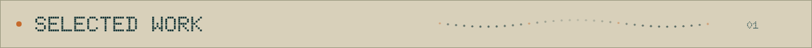

<table>
<tr>
<td width="50%" valign="top">

<a href="https://github.com/Unimend/UnityRender-BaseLearn">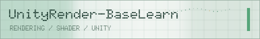</a>

Studies in real-time rendering, ShaderLab and the visual logic behind a production image.

</td>
<td width="50%" valign="top">

<a href="https://github.com/Unimend/Unimend-Webpage">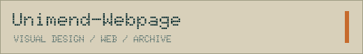</a>

An evolving personal space for visual experiments, notes and unfinished thoughts.

</td>
</tr>
<tr>
<td width="50%" valign="top">

<a href="https://github.com/Unimend/nothing-keyboard">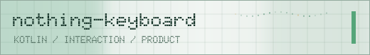</a>

An Android keyboard shaped as much by typography and interaction as by implementation.

</td>
<td width="50%" valign="top">

<a href="https://github.com/Unimend/nothing-weather-widget">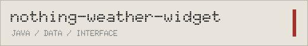</a>

Weather and air-quality data translated into a quiet, glanceable visual object.

</td>
</tr>
</table>

<a href="https://github.com/Unimend?tab=repositories">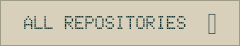</a>

 

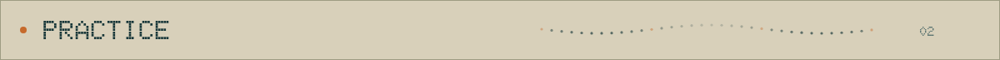

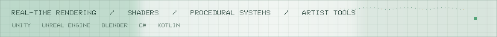

My practice moves between **observation**, **construction**, and **iteration**. Tools are not separate from aesthetics; they quietly determine which images are possible.

 

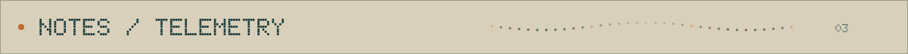

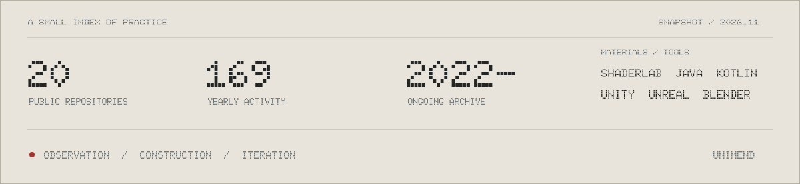

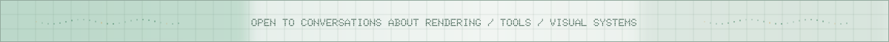

